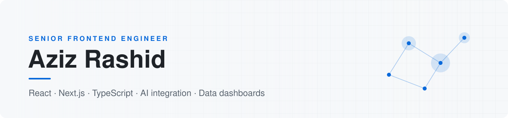

<picture>
  <source media="(prefers-color-scheme: dark)" srcset="./banner-dark.svg">
  
</picture>

I build frontends for data-heavy products. At **[Horsefly Analytics](https://horseflyanalytics.com)** I work on a labor-market analytics platform used by talent teams in 60+ countries: dashboards, Mapbox maps over 170,000+ towns and cities, PDF reporting, authentication and LLM-powered search, in React, Next.js and TypeScript.

Before that I built a parcel-tracking platform end to end, legal-services and e-commerce frontends, Web3 interfaces, and HubSpot CMS sites for freelance clients. 8+ years in total, mostly remote with UK and US teams.

### What I work with

| Area | Tools |
| :-- | :-- |
| **Frontend** | React, Next.js, TypeScript, JavaScript, Tailwind CSS, Material UI, Redux Toolkit, Zustand, React Query |
| **Data and maps** | Dashboards, Mapbox GL JS, Chart.js, MUI Data Grid, PDF and Excel export |
| **AI** | OpenAI API, Claude API, LLM integration, RAG, Claude Code, Cursor |
| **Backend** | Node.js, Express, GraphQL, REST, MongoDB, PostgreSQL, Firebase, Supabase |
| **CMS** | HubSpot CMS (HubL), Sanity, headless WordPress |
| **Delivery** | Jest, React Testing Library, Git, GitHub Actions, Docker, Vercel, AWS |

### Selected work

| Project | What it is | Stack |
| :-- | :-- | :-- |
| **[Pulsar Dashboard](https://github.com/Aziz-Rashid/Pulsar-V2-MVP)** | Dashboard MVP with data grids, date filters and charts | Next.js, TypeScript, MUI, Redux Toolkit, Chart.js |
| **[LLM Self-Engagement](https://github.com/Aziz-Rashid/LLM-self-engagement)** | Two AI chatbots hold a conversation from one user prompt | Next.js, OpenAI API |
| **[ACR Logistics](https://github.com/Aziz-Rashid/ACR_Log_APP)** · [demo](https://acr-test.vercel.app) | Logistics app with role-based dashboards, maps and report export | Next.js, Firebase, Google Maps, ExcelJS |
| **[Nexux](https://github.com/Aziz-Rashid/Nexux)** · [demo](https://nexux-coin.vercel.app) | Web3 site with wallet sign-in | Next.js, WalletConnect, Web3Auth, Moralis |
| **[Zealthy](https://github.com/Aziz-Rashid/Zealthy)** · [demo](https://zealthy-gamma.vercel.app) | Frontend for a US telehealth website | Next.js, TypeScript, Material UI |
| **[NY Times Articles](https://github.com/Aziz-Rashid/NY-TIME-ARTICLE-APP)** · [demo](https://ny-time-article-app.vercel.app) | Most-popular articles viewer with unit tests | React, TypeScript, Jest, Testing Library |

Most of my production work is in private company repositories, so this profile shows a sample rather than everything.

### Where I go deep

- **Data-heavy UIs** — dashboards, maps and tables that stay fast with large datasets, using server-side rendering and caching.
- **AI features in real products** — natural-language search and chat interfaces built on the OpenAI and Claude APIs.
- **CMS-driven sites** — content models in HubSpot and Sanity that let marketing teams publish without a developer.

### Contact

[LinkedIn](https://www.linkedin.com/in/azizrashid) · [Portfolio](https://azizz-portfolio.vercel.app) · Open to remote roles and relocation
